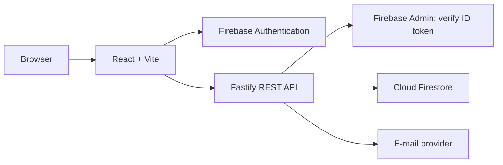

# Plann.er — Collaborative Trip Planning

**A full-stack application for organizing trips, inviting people, and coordinating travel plans in one place.**

[**Live application**](https://www.planner.thiagolinch.com.br/) · [**Source code**](https://github.com/thiagolinch/plannertrip) · [**Developer portfolio**](https://thiagolinch.com.br/)

> **PT-BR:** O Plann.er é uma aplicação full-stack para planejamento colaborativo de viagens. Permite organizar destinos e datas, convidar participantes, acompanhar confirmações, montar atividades e centralizar links úteis. A aplicação está publicada em [planner.thiagolinch.com.br](https://www.planner.thiagolinch.com.br/).
>
> **Live deployment:** This is the published application URL provided by the maintainer. The repository itself does not constitute a live availability or uptime guarantee.

## Why this project?

Planning a group trip usually involves fragmented conversations, invitations, activity schedules, and useful links scattered across different tools. Plann.er brings these workflows together in a single web application.

The project demonstrates more than UI development: it combines a React frontend, an HTTP API, identity verification, authorization rules, NoSQL persistence, e-mail integrations, input validation, and automated API testing.

## Features

- **Google sign-in:** Firebase Authentication on the web and Firebase ID token verification on protected API routes.
- **Trip management:** Create trips with a destination and start/end dates; view, update, confirm, and delete trips.
- **Collaborative invitations:** Invite people by e-mail, maintain participants, and track confirmations.
- **Activity scheduling:** Add and manage activities associated with a trip, with date validation against the travel period.
- **Useful links:** Store and manage links relevant to each trip.
- **Trip dashboard:** View trips associated with the authenticated account.
- **Transactional e-mails:** Send trip and invitation confirmation messages, with a configurable delivery provider.

Some confirmation flows use e-mail links. They depend on valid application URLs and correctly configured mail delivery.

## Tech stack

| Layer | Technology | Role |
| --- | --- | --- |
| Frontend | React 18, TypeScript, Vite | Single-page application |
| UI | Tailwind CSS, Tailwind Variants, Lucide React | Interface and reusable styling |
| Navigation | React Router | Client-side routes and protected pages |
| HTTP client | Axios | Web-to-API communication |
| Backend | Node.js, Fastify, TypeScript | REST API and business workflows |
| Validation | Zod, fastify-type-provider-zod | Request schemas and runtime validation |
| Identity | Firebase Authentication, Firebase Admin | Google login and server-side token verification |
| Data | Cloud Firestore | Trips, participants, activities, and links |
| E-mail | Nodemailer; configurable Resend HTTP delivery | Confirmation and invitation messages |
| Monorepo | npm Workspaces, Turborepo | Workspace organization and task orchestration |
| Testing | Vitest | API tests, including mocked infrastructure |

**Architecture note:** An earlier version of this README referenced Prisma and SQL migrations. The current inspected API uses **Firebase Admin + Cloud Firestore**, not Prisma.

## Architecture

```text
plannertrip/
├── apps/
│   ├── web/                      # React + TypeScript + Vite
│   │   └── src/
│   │       ├── components/
│   │       ├── pages/
│   │       └── lib/              # Firebase web initialization, etc.
│   └── api/                      # Fastify + TypeScript
│       └── src/
│           ├── routes/           # Trips, participants, activities, links
│           ├── middlewares/      # Firebase authentication
│           ├── lib/              # Firebase Admin, mail, shared utilities
│           ├── app.ts            # Route registration and validation
│           └── server.ts         # HTTP bootstrap
├── package.json                  # npm workspaces and root scripts
├── turbo.json                    # Task pipeline
└── README.md
```



### Implementation decisions

**Separated applications in one monorepo.** The web application and API have independent responsibilities while sharing a consistent development workflow through npm Workspaces and Turborepo.

**Authentication and authorization are different concerns.** The frontend manages the Firebase session; protected API endpoints verify bearer tokens server-side. Certain operations additionally check whether the caller is associated with a trip or is its organizer.

**Document-oriented persistence.** Firestore stores trip-related records in collections such as `trips`, `participants`, `activities`, and `links`. Relations are represented through identifiers such as `trip_id`, rather than SQL foreign keys.

**Explicit validation and error handling.** Fastify route schemas use Zod to validate requests. Trip creation validates the date range, and activity creation checks that activities fall within the trip period.

**Testable HTTP application.** The Fastify instance is created in `buildApp()`, separately from the server bootstrap. API tests can instantiate the application and mock external dependencies.

These are descriptions of the inspected implementation, not claims of independent security certification or production-scale benchmarking.

## Local development

### Prerequisites

- Node.js and npm (the root `package.json` specifies `npm@10.8.2`).
- A Firebase project configured for Authentication and Firestore, or suitable local emulator credentials/configuration.
- E-mail delivery configuration for testing real invitation and confirmation messages.

### Install and run

From the repository root:

```bash
npm install
npm run dev
```

The root commands orchestrate workspaces with Turborepo:

| Command | Purpose |
| --- | --- |
| `npm run dev` | Start workspace development tasks |
| `npm run build` | Build workspaces |
| `npm run lint` | Run configured workspace lint tasks |
| `npm run test` | Run configured workspace test tasks |

The web development configuration expects a Vite application (typically at `http://localhost:5173`). The API environment defines a default `PORT` of `3333` for configuration, while its server bootstrap uses `process.env.PORT || 3000`. **Set `PORT=3333` explicitly** if you need the API to match the local URL defaults.

### Environment variables

Provide the appropriate values for each workspace using its supported environment-loading mechanism. Do not commit actual credentials or service-account private keys.

**Web (`apps/web`, Vite):**

```dotenv
VITE_FIREBASE_API_KEY=
VITE_FIREBASE_AUTH_DOMAIN=
VITE_FIREBASE_PROJECT_ID=
VITE_FIREBASE_STORAGE_BUCKET=
VITE_FIREBASE_MESSAGING_SENDER_ID=
VITE_FIREBASE_APP_ID=
```

These are Firebase **web client configuration fields**, not Firebase Admin service-account credentials. Ensure the chosen Firebase Authentication provider and authorized domains are configured.

**API (`apps/api`):**

```dotenv
PORT=3333
FIREBASE_PROJECT_ID=
FIREBASE_CLIENT_EMAIL=
FIREBASE_PRIVATE_KEY=
API_BASE_URL=http://localhost:3333
WEB_BASE_URL=http://localhost:5173

# Optional: configure real e-mail delivery
SMTP_HOST=
SMTP_PORT=
SMTP_USER=
SMTP_PASS=
SMTP_SECURE=false
MAIL_FROM=
```

The API reads environment variables through `dotenv` in its server bootstrap. The Firebase Admin initializer can use explicit service-account credentials or application environment credentials; configure these appropriately for the selected deployment platform. For local development without mail credentials, the mail integration can fall back to an Ethereal test account.

Some hosting environments restrict SMTP connections. The mail integration includes a provider-specific HTTP path for a Resend configuration.

**Important:** Check environment configuration and Firebase rules/permissions before exposing a new deployment. Local defaults are not production credentials.

## API overview

The routes registered in `apps/api/src/app.ts` cover these domains:

| Domain | Examples of operations |
| --- | --- |
| Trips | Create, list, read details, update, confirm, delete |
| Participants | List, view, update, confirm, remove |
| Invitations | Invite participants to a trip |
| Activities | Create, list, update, delete |
| Links | Create, list, update, delete |

See `apps/api/src/routes/` for the exact HTTP paths, authentication requirements, request schemas, and response contracts. Not all routes share the same authentication rules; confirmation links have their own flow.

## Testing and engineering practices

The API includes a **Vitest** test configuration and route tests under `apps/api/src/routes/`. The inspected route test uses mocked Firestore collections and mocked mail delivery to exercise API behavior without sending real messages or writing to a production database.

To execute API tests directly:

```bash
npm run test --workspace=@planner/api
```

This README does not claim a specific test coverage percentage, passing CI status, or load-test result because those metrics have not been independently verified.

## Deployment

**Web app:** [www.planner.thiagolinch.com.br](https://www.planner.thiagolinch.com.br/)

The web frontend and API can be deployed independently, with their environment values configured for the intended origin and API endpoint. The Fastify app explicitly configures CORS for the production planner domains and local development.

For a production deployment, verify Firebase authorized domains, API URL configuration, e-mail sender/domain settings, server credentials, and the frontend's API base URL. A successful build alone does not validate these external integrations.

## Engineering trade-offs and future improvements

The system has a functional product scope, but it also presents opportunities for further hardening:

- Add CI checks with a reproducible build and test pipeline.
- Document endpoint contracts with generated OpenAPI documentation.
- Expand automated tests for authorization, invitation edge cases, and cross-user access.
- Review multi-document mutation consistency and failure recovery for workflows that write several Firestore documents.
- Align the API server's default port with the environment schema to avoid setup ambiguity.
- Add observability, operational health checks, and explicit production configuration guidance.

These are potential engineering improvements, not promises of completed features.

## Author

Developed and maintained by **Thiago Linch**, a software developer focused on backend and full-stack applications.

- [Portfolio](https://thiagolinch.com.br/)
- [GitHub](https://github.com/thiagolinch)

---

**Try Plann.er:** [Open the live web application](https://www.planner.thiagolinch.com.br/)
